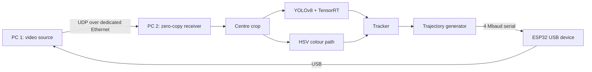

A closed-loop control system built under a strict latency budget, from October 2025 to May 2026. One PC produces video, a second PC analyses it, and an ESP32 microcontroller sends the resulting commands back to the first PC as if it were a physical USB device.

## Architecture

## Measured results

- **Colour-trigger path:** about 7 ms from a colour appearing on PC 1 to the ESP32 sending its signal back, with the detector written in C. The same path in Python measured about 16 ms.
- **Neural path:** YOLOv8 with TensorRT FP16 at 60 FPS on a 2560×1440 stream.
- **HSV path:** up to 240 FPS on a 480×360 region, which is more than the Ethernet stream delivers.

## Engineering

- **Streaming without HDMI capture:** video travels over a dedicated Ethernet link as raw UDP. I wrote the receiver at socket level, with a 16 MB receive buffer, and scan the byte stream for JPEG start and end markers in place rather than using a video library. Decoding uses libjpeg-turbo.
- **Removing garbage-collection stalls:** copying multi-megabyte buffers on every packet caused visible stutter in Python. Slicing the buffer in place removed the allocations.
- **Dropping bad frames:** after packet loss the decoder fills gaps with flat blocks. A fast NumPy range check discards those frames before they reach the models.
- **Concurrency:** capture, inference and serial output run in separate threads linked by condition variables, so a slow inference step cannot block the output link.
- **Tracking:** a lightweight IoU-based tracker keeps a stable ID per object when several overlap.
- **Smooth, accurate output:** trajectories are generated by integrating simple physics (attraction toward the target plus noise and drag). Because the output device accepts only whole-number steps, a fractional carry accumulator keeps rounding errors from building up.
- **Studying the target environment:** I studied how kernel-mode anti-cheat systems monitor and classify input and system behaviour, to inform the design.
- **Custom serial protocol:** the ESP32 enumerates as a USB input device and takes commands over a 4 Mbaud serial link.

## Stack

Python, C, PyTorch, Ultralytics YOLOv8, NVIDIA TensorRT, OpenCV, NumPy, libjpeg-turbo, UDP sockets, OBS, ESP32 firmware, USB HID.
