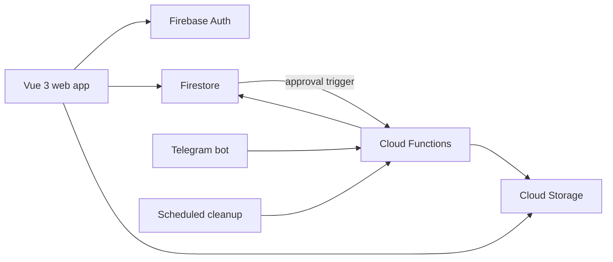

While serving as a narcotics detection dog handler and field training officer in the Singapore Police Force K-9 Unit, I designed, built and deployed a web application for my base's case records and shift reporting. I built it between April 2025 and July 2026 and have only maintained it since leaving the unit. It has been used by roughly 30 officers at the base.

## The problem

Records were logged by hand, photos had to be passed between phones and desktops, and shift reports were compiled manually. Each step cost time and risked lost or inconsistent data.

## What it does

- **Digital case logging and retrieval:** officers record cases as they happen, and the team can search past cases.
- **Controlled access:** new users request access and an administrator approves them. Approval triggers an automatic password-setup email, so nobody shares an account.
- **Shift-aware reporting:** a calculator pre-fills the right configuration for the current shift, saves its state on every keystroke so a refresh loses nothing, and exports a formatted CSV.
- **Photo upload from the field:** officers send photos through a Telegram bot linked to their account. Files are stored with the uploader and a timestamp, so there is an audit trail.
- **Shared notes:** collaborative notes with soft delete and a scheduled job that purges old deletions after seven days.

## Engineering

- **Serverless backend:** Firebase Cloud Functions handle the Telegram webhook, the approval workflow and the scheduled cleanup, with secrets held in Google Cloud Secret Manager.
- **Auth race condition:** the app showed a blank page on direct navigation because routing resolved before Firebase had restored the session. I fixed it by deferring route guards until authentication is ready.
- **Fewer database writes:** note edits are debounced, so one write is sent after a pause rather than one per keystroke.
- **Browser limits:** I worked around cross-origin download restrictions and the clipboard's image-format limits, and set up CORS rules on the storage bucket.

## Stack

Vue 3 (Composition API), Vite, Vue Router, Firebase (Auth, Firestore, Storage, Cloud Functions), Telegram Bot API, Vercel.
